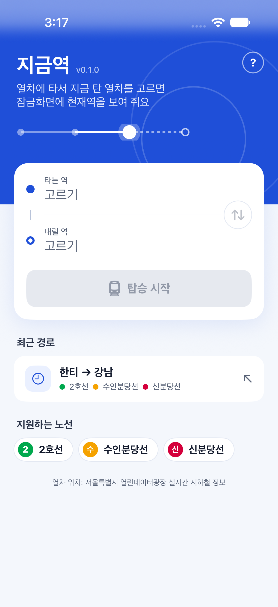
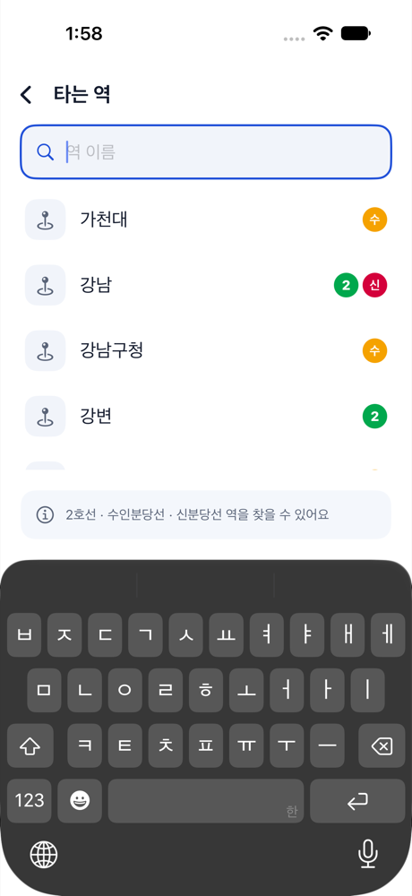
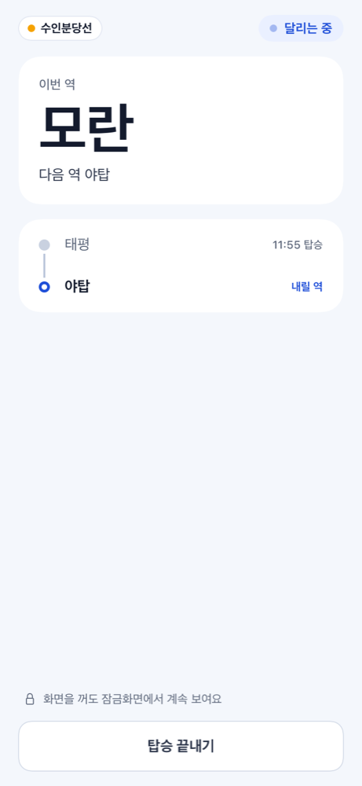
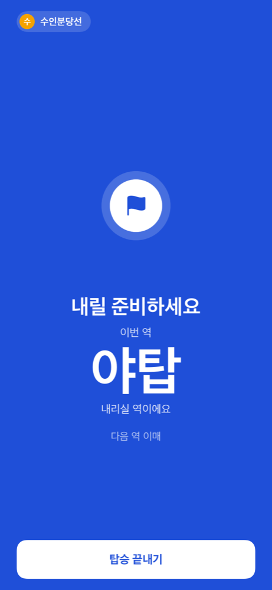

# NowStation iOS (지금역)

지하철에서 **지금 무슨 역인지**를 잠금화면과 다이나믹 아일랜드에 보여 주는 앱의 iOS 버전입니다.
타는 역만 고르고 시작하면, 열차에 탄 순간 그 열차를 찾아 따라가고 내릴 역 직전에 알려 줍니다.

- 탄 열차를 찾는 판단은 서버가 합니다 → [NowStation-Server](https://github.com/sinadsl1457/NowStation-Server)(구조도와 판단 원리)
- 먼저 만든 Android 앱(Google Play 출시 준비 중) → [NowStation-Android](https://github.com/sinadsl1457/NowStation-Android)
- 이 iOS 앱은 화면·문구·판단 규칙을 Android와 같게 옮겼고, **무료 Apple 계정으로 내 폰에 설치해 실제 지하철에서 시험하는 용도**입니다.

| 홈 | 역 검색 | 탑승 중 | 내릴 역 직전 |
|---|---|---|---|
|  |  |  |  |

<sub>홈·역 검색은 시뮬레이터에서 실제 서버를 상대로 UI 테스트가 누르며 찍은 화면, 탑승 중·내릴 역 직전은 같은 화면 코드를 테스트에서 그린 것입니다(실제 열차 없이는 그 상태가 되지 않아서).</sub>

## 기술적으로 신경 쓴 부분

| 문제 | 해결 |
|---|---|
| 무료 Apple 계정은 **APNs(서버 푸시)를 쓸 수 없음**. 그런데 iOS는 화면을 끄면 앱을 곧 재워서 서버 상태를 받아 올 수 없음 | 탑승하는 동안만 위치 갱신을 켜 둔다(`UIBackgroundModes: location` + `CLBackgroundActivitySession`). 앱이 깨어 있게 하려는 것이고 위치 값은 쓰지 않는다(지하라 부정확). 탑승을 끝내면 바로 끈다 |
| 서버 푸시 없이 잠금화면을 바꿔야 함 | Live Activity를 **앱이 직접** 갱신한다. 내릴 역 직전에는 `AlertConfiguration`으로 잠금화면을 켜고 소리를 내고, 로컬 알림과 진동을 함께 보낸다 |
| 가속도 센서는 속도가 바뀌는 순간만 느껴서, 일정하게 달리는 열차와 멈춘 열차를 구분하지 못함 | 상태를 재지 않고 **사건만** 잡는다: 4초 넘게 이어지는 가속 = 출발, 출발과 반대 방향 감속이 끝남 = 도착. Android의 판단 규칙을 그대로 옮기고 **같은 합성 신호 테스트**로 맞춘 결과인지 확인 |
| 지하에서 연결이 자주 끊김 | 끊겨도 마지막 역을 그대로 보여 주고 "연결 끊김"만 표시. 못 보낸 움직임은 쌓아 뒀다가 다시 연결되면 한꺼번에 보낸다(서버는 늦게 온 움직임도 일어난 시각대로 판단) |
| 두 플랫폼의 문구가 어긋나기 쉬움 | 화면과 잠금화면 문구를 `RideTexts` 한곳에 두고, Android와 같은 문장인지 테스트로 고정 |
| 공개 저장소에 서버 주소(EC2 IP)를 올리지 않아야 함 | 주소는 저장소에 안 올라가는 `Config/Local.xcconfig`에만 둔다. 없으면 이 컴퓨터의 서버(`http://localhost:8080/`)를 본다 |

### 한계(무료 계정, 개인 테스트용)
- 7일마다 Xcode로 다시 설치해야 한다(무료 서명 만료). 한 폰에 무료 서명 앱은 3개까지
- 탑승 중 앱을 위로 밀어 강제 종료하면 멈춘다(APNs가 없어 다시 깨울 방법이 없음)
- 움직임 판단 기준값은 Android와 같은 값으로, 실제 지하철에서 다시 맞춰야 한다

## 구조

```
NowStation/
├ App/       진입점. 탑승 중이면 탑승 화면, 아니면 홈
├ Core/      서버 API(연결 실패·404·400·서버 오류 구분), 색·노선 칩(위젯과 같이 씀)
├ Station/   홈·역 검색·최근 경로(HomeViewModel)
└ Ride/      진행 중인 탑승(RideTracker: 화면이 사라져도 계속돼야 해서 앱에 하나)
   ├ Motion/      가속도 → 출발·도착 사건(순수 Swift)
   └ Background/  RideRunner: 깨어 있기, 센서 20Hz, 5초 갱신, Live Activity, 내릴 역 알림
Shared/           Live Activity 데이터 모양(앱 + 위젯)
NowStationWidget/ 잠금화면·다이나믹 아일랜드
```

Swift·SwiftUI·Observation(iOS 17+), 외부 라이브러리 없음. 프로젝트 파일은 [XcodeGen](https://github.com/yonaskolb/XcodeGen)이 `project.yml`로 만든다.

## 테스트

**19개**(`xcodebuild test -scheme NowStation -destination 'platform=iOS Simulator,name=iPhone 18 Pro'`)
- 움직임 판단 7개: Android와 같은 합성 신호(정차·출발·감속, 두 정거장 연속, 걷는 흔들림, 짧은 밀림, 폰 돌리기, 달리는 중 재가속)
- 탑승 상태 5개: 지하 끊김 → 쌓았다 보내기, 서버가 탑승을 모름, 내릴 역 알림은 한 번만, 최근 경로, 문구
- 바꾸기 2개: 타는 역 ↔ 내릴 역(퇴근길), 내릴 역만 골랐을 때
- 검색 취소 2개: 한글 입력 중 앞 검색을 취소한 것을 "서버에 연결할 수 없어요"로 띄우던 버그(실기기에서 발견, 실패하는 테스트로 고정 후 수정)
- 화면 그리기 2개(탑승·내릴 준비, 노선 둘인 역을 좁은 폭 402·375·320pt에서), UI 흐름 1개(실제 서버를 상대로 역 고르기 → 탑승 시작 → 끝내기 → 최근 경로)

## CI/CD

- **CI**(`.github/workflows/ios.yml`): main에 push하면 GitHub의 맥 서버가 XcodeGen으로 프로젝트를 만들고 빌드 + 단위 테스트 18개. 문서만 바꾼 push는 건너뜀. UI 테스트는 실제 서버에 붙어야 해서 로컬에서만
- **CD는 없음**: TestFlight·App Store는 유료 개발자 계정이 필요하고, 무료 서명은 맥에 폰을 연결해야 만들어져서 서버에서 할 수 없다. 설치는 맥에서 `xcodebuild -configuration Release ... -allowProvisioningUpdates` → `xcrun devicectl device install app`

## 실행

1. `brew install xcodegen` → `xcodegen generate`
2. 서버 주소(선택): `Config/Local.xcconfig`에 `API_BASE_URL = https:/$()/<서버 주소>/`. 없으면 이 컴퓨터의 서버(서버 저장소의 재생 모드로 실제 녹화 데이터를 흘릴 수 있다)
3. Xcode에서 `NowStation.xcodeproj`를 열고 Signing의 Team을 내 계정으로 → 실행
